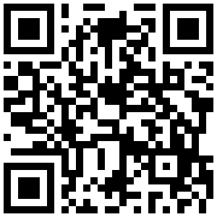

# 共识实验室

区块链课程第一次汇报的“选题 1”课堂演示：让全班用手机或电脑加入同一间临时房间，完成交易签名、广播、挖矿出块、双花冲突、同时出块与 51% 重组。

这是一个**教学模拟**。页面里的 CB 没有价值、不能兑换，也不连接任何真实钱包或比特币网络。

[打开在线课堂](https://liaoy256.github.io/consensus-lab/)



## 功能

- 扫码创建或加入课堂房间，每台设备拥有独立会话身份
- 浏览器 Web Crypto 生成 ECDSA P-256 签名密钥，转账由本机签名
- 浏览器实际执行 SHA-256 nonce 搜索，验证区块的简化 PoW
- 交易进入待确认区，挖到区块后才计入主链
- 双花实验只允许一笔冲突交易进入主链
- 同时出块保留两条分支，并根据课堂规则重新选择主链
- 教师标记逾半节点后可演示近期历史重组
- 完整交易流水、财富排行、CSV 导出和课堂复盘
- 手机端与投影大屏响应式适配，所有 CSS、JS、字体回退和二维码生成均本地加载，不依赖 CDN

## 课堂使用

1. 用电脑打开网页，输入昵称，点击“创建课堂房间”。
2. 等待房间状态显示“房间已上线”，点击右上角 `QR` 展示二维码。
3. 学生扫码，输入昵称加入。每台设备都会同步同一份账本。
4. 先做几笔转账，再让同学点击“开始挖矿”。先找到满足三个前导零的哈希者出块。
5. 依次演示“双花”“分叉”和“51%”。51% 演示前需先让攻击联盟中的节点转出一笔且已入块。
6. 点击“课堂复盘”展示主链高度、完整交易、非主链区块和最终财富排行。

教师台可以加入 5 个示例节点，便于单人彩排；示例节点不是实际扫码参与者。

## 与真实比特币的关系

| 环节 | 课堂游戏 | 真实比特币 |
| --- | --- | --- |
| 密钥 | ECDSA P-256 | secp256k1 上的 ECDSA / Schnorr |
| 账本模型 | 地址余额 | UTXO |
| PoW | 一次 SHA-256，固定三个前导零 | 双 SHA-256 区块头，目标由全网难度决定 |
| 难度 | 固定 | 每 2,016 块调整一次，目标约 10 分钟一块 |
| 奖励 | 每块 8 CB，另有课堂初始币 | 约每 210,000 块减半；2024 年后为 3.125 BTC，长期不超过 2,100 万 BTC |
| 同步 | 主持人页面保存快照，公共 MQTT 中继广播 | 无中心服务器的 P2P 广播，每个全节点独立验证 |
| 分叉选择 | 同高度按哈希规则稳定演示 | 选择累计工作量最大的有效分支 |

51% 攻击的真实边界也写在页面“规则对照”中：多数算力能审查交易或对自己近期发出的交易做重组式双花，但不能在没有私钥的情况下伪造其他地址的有效签名。

## 技术说明

网页是普通静态站点，可放在 GitHub Pages。页面运行时不加载任何外部字体、图标、CSS、图片或分析脚本。跨设备同步使用浏览器直接连接公共 MQTT WebSocket 中继 `broker.emqx.io:8084`，房间消息每次完成后推送完整状态快照。

课堂中继使用随机六位房间号作为临时主题。它只适合公开课堂的低价值演示，不应传送密码、真实身份、钱包私钥或其他敏感信息。若正式活动要求更强隐私或多班同时使用，应把 `MQTT_BROKER` 替换为自建 MQTT WebSocket 服务。

## 本地预览

在项目目录运行：

```powershell
python -m http.server 4173 --bind 127.0.0.1
```

然后打开 `http://127.0.0.1:4173/`。不要直接双击 `index.html`，手机扫码访问依赖 HTTP/HTTPS 地址。

## 文件

- `index.html`：页面结构和课程内容
- `styles.css`：桌面、手机与投影模式样式
- `app.js`：身份、签名、PoW、账本规则和 MQTT 同步
- `vendor/`：本地二维码生成器
- `scripts/e2e-room.cjs`：双浏览器联网同步测试

## 验证

```powershell
node --check app.js
$env:BASE_URL='https://liaoy256.github.io/consensus-lab/'; node scripts/e2e-room.cjs
```

联网测试需要本机启动本地服务器，并允许浏览器访问 MQTT WebSocket。
